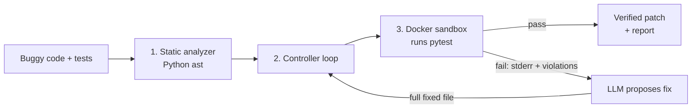

# PatchPilot

**A self-healing code agent.** PatchPilot finds risky patterns in Python code with static analysis,
runs the code's tests inside a locked-down Docker sandbox, and asks an LLM to patch the code until
the tests pass, with a maximum of 3 attempts.


> 🚧 **Work in progress.** This project is being built stage by stage, test-first.
> See the [Build status](#build-status) section for exactly what works today and what is still planned.

---

## How it works



1. **Static analyzer:** walks the code's AST and flags risky patterns such as `eval`/`exec`,
   `open()` without `with`, raw SQL strings, and I/O without error handling.
2. **Controller loop:** sends the failing test output and analyzer findings to the LLM, then
   applies the returned fix. It stops on success or after `MAX_RETRIES` attempts.
3. **Sandbox:** runs `pytest` against the candidate code in a throwaway container with strict
   resource and security limits, and reports the exit code, stdout/stderr, timeouts and OOM kills.

## Build status

| Stage | Component | Status |
| --- | --- | --- |
| 0 | Project setup: `uv`, Docker image `sandbox-runner`, config, data models | ✅ Done |
| 1 | **Sandbox runner**: `run_in_sandbox()` in [`src/selfheal/sandbox/runner.py`](src/selfheal/sandbox/runner.py) | 🔨 **Building now**: 7 integration tests written, implementation in progress |
| 2 | AST rules engine: `analysis/rules.py`, `analysis/engine.py` | ⏳ Planned |
| 3 | Controller loop with retry and feedback (tested with a fake LLM and a fake sandbox) | ⏳ Planned |
| 4 | OpenAI integration: structured output, local diff with `difflib` | ⏳ Planned |
| 5 | Interfaces: report, Rich CLI, Streamlit dashboard | ⏳ Planned |
| 6 | Demo scenarios (memory leak, `eval`, infinite loop) | ⏳ Planned |

**What works today:** configuration (`Settings`), the `SandboxResult` model, the sandbox Docker
image, the tar helper used to copy files into the container, and the full Stage 1 test suite.
**What does not work yet:** `run_in_sandbox()` itself (the tests are red on purpose; this is TDD),
the analyzer, the agent loop, the LLM wiring and the CLI.

## Sandbox design (Stage 1)

AI-generated code is untrusted, so every run happens in a fresh container that is always removed
afterwards. The limits below are the target design that the Stage 1 tests check:

| Wall | Setting | Why |
| --- | --- | --- |
| Memory | `mem_limit=256m`, `memswap_limit` = same | stops memory leaks; no swap escape |
| CPU | 1 core | one runaway loop cannot freeze the host |
| Processes | `pids_limit=64` | blocks fork bombs |
| Time | `wait(timeout=5s)` then `kill()` | infinite loops are reported as `timed_out` |
| Network | disabled | code cannot call home or download anything |
| Privileges | `cap_drop=["ALL"]`, `no-new-privileges`, non-root `user=1000` | limits what an escape could do |
| Filesystem | read-only root, tmpfs `/tmp` | code cannot change the image |

Files are copied in with `put_archive` (not `python -c`) and the run uses
`create → start → wait → logs → remove(force=True)`, so the exit code and the `OOMKilled` flag are
never lost.

Stage 1 tests ([`tests/test_sandbox.py`](tests/test_sandbox.py)):

- [ ] passing code succeeds
- [ ] failing assertion is reported as a failure
- [ ] two files can import each other
- [ ] infinite loop is killed by the timeout
- [ ] memory hog is reported as OOM
- [ ] network is blocked
- [ ] no container is left behind

## Tech stack

Python 3.11 · [uv](https://docs.astral.sh/uv/) · Docker SDK for Python · Pydantic v2 ·
OpenAI API · pytest · Ruff · Rich *(planned)* · Streamlit *(planned)*

## Getting started

Requirements: Python 3.11+, [uv](https://docs.astral.sh/uv/), and Docker Desktop (running).

```bash
git clone https://github.com/Kaydenletk/PatchPilot.git
cd PatchPilot
uv sync
docker build -t sandbox-runner:latest -f sandbox/Dockerfile.runner sandbox/
cp .env.example .env    # add your OPENAI_API_KEY (needed from Stage 4)
```

Run the tests:

```bash
uv run pytest -v                    # all tests (Docker tests skip if the daemon is not running)
uv run pytest tests/test_sandbox.py # Stage 1 only
uv run ruff check .
```

> The `selfheal` CLI command declared in `pyproject.toml` is not implemented yet (Stage 5).

## Configuration

| Variable | Default | Meaning |
| --- | --- | --- |
| `OPENAI_API_KEY` | none | OpenAI key (never committed) |
| `OPENAI_MODEL` | `gpt-5` | model used for patches |
| `SELFHEAL_TIMEOUT_S` | `5` | sandbox time limit per run |
| `SELFHEAL_MAX_RETRIES` | `3` | maximum patch attempts |

## Project layout

```text
src/selfheal/
├── config.py          # all limits in one place (Settings)
├── models.py          # SandboxResult (frozen Pydantic model)
└── sandbox/runner.py  # run_in_sandbox()  ← Stage 1, in progress
sandbox/Dockerfile.runner  # python:3.11-slim + pytest, non-root user
tests/                     # pytest suite (Docker tests marked `docker`)
docs/GUIDE.md              # roadmap and build notes
learn/                     # warm-up exercises (pytest, Docker SDK)
```

## Roadmap

The full stage-by-stage plan and design notes are in [docs/GUIDE.md](docs/GUIDE.md).
